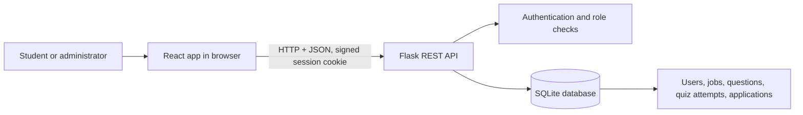
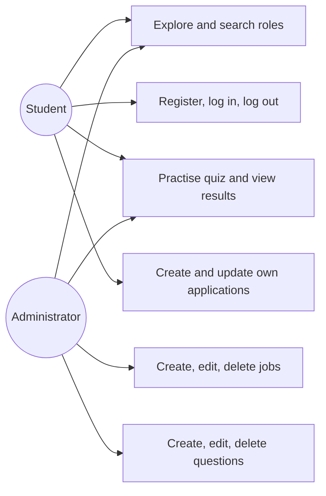
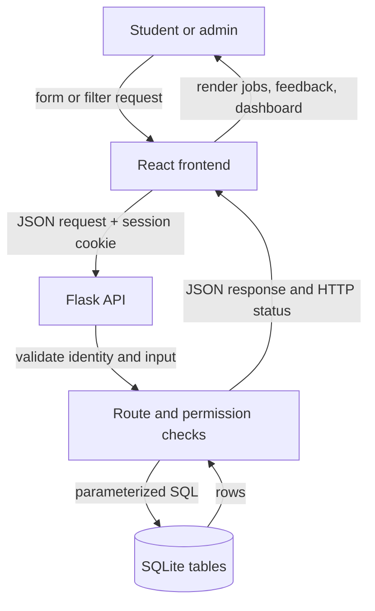
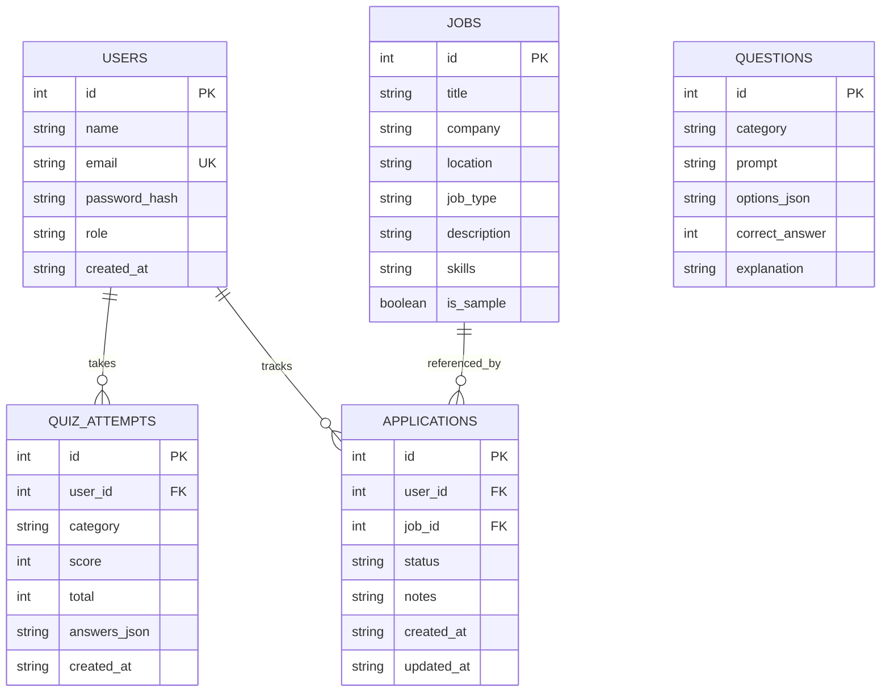

# Student Placement Preparation System — Project Report

## Abstract

The Student Placement Preparation System is a local web application for college students preparing for internships and entry-level jobs. It brings together fictional sample opportunities, interview practice questions, saved quiz results, and an application status tracker. React provides the interface, Flask validates and serves JSON API requests, and SQLite stores users and project data. Passwords are stored as salted PBKDF2-SHA256 hashes. Students can see only their own quiz results and applications. Administrator routes check a user's role on the server. Sample listing content is fictional and does not represent current vacancies.

## Introduction

Students often keep job notes, practice questions, and application updates in separate places. This project demonstrates how a small web system can bring those learning activities together. It also demonstrates core full-stack concepts: a frontend, a backend, a REST API, sessions, database relationships, and role-based access.

## Problem statement

Students need a simple place to explore the skills requested by example roles, practise common interview topics, and track preparation progress. A learning project should demonstrate these tasks without presenting invented sample opportunities as real vacancies.

## Objectives

- Show role listings stored in a relational database, with search and filters.
- Let students create accounts and sign in without storing plaintext passwords.
- Score practice answers on the server and save attempts for the correct student.
- Let a student track opportunity status privately.
- Give authorized administrators tools to manage sample roles and questions.
- Document and test the system with an understandable design.

## Existing system and limitations

Without a shared preparation tool, notes and status updates can be scattered across documents and spreadsheets. A spreadsheet does not enforce per-student access or calculate quiz results on a trusted server. This project demonstrates a consolidated local alternative; it does not integrate with job boards or employer systems.

## Proposed system

React displays pages and sends JSON over HTTP to Flask. Flask validates input, checks the signed session and role, then uses parameterized SQL through Python's SQLite module. SQLite stores the data. Quiz scoring is performed in Flask, while sessions associate private results and applications with their owner.

## Requirements

### Functional requirements

- Public home page, jobs listing, search, type/location filtering, and job details.
- Registration, login, logout, and current-user lookup.
- Public question bank and server-scored quiz; logged-in attempts are saved and personal results are private.
- Authenticated application creation, listing, and status update.
- Admin-only job and question listing, creation, editing, and deletion.

### Non-functional requirements

- Responsive, readable interface with labels and status feedback.
- Password hashes instead of plaintext; JSON responses do not include hashes.
- Parameterized SQL and ownership checks on private records.
- Local CORS origin restriction, useful HTTP status codes, and SQLite foreign keys.
- Simple local setup without paid services or a separate database server.

### Hardware and software requirements

- A Mac or comparable computer with a modern browser.
- Python 3.9+, Node.js 20+, npm, and VS Code.
- Flask, Flask-CORS, React, Vite, and SQLite (included with Python).

## System architecture

The frontend runs on local port 5173. Flask serves the API on port 5000. CORS allows the configured frontend origin, and credentialed requests send the HttpOnly session cookie.

## Use-case diagram

## Data-flow diagram

## Entity-relationship diagram

One user may have many quiz attempts and application records. Each application references one job, and a user cannot track the same job twice. Questions are shared practice content and are not directly owned by a student.

## Database schema

| Table | Main columns and rules |
| --- | --- |
| `users` | Integer primary key; unique case-insensitive email; name; PBKDF2 password hash; role constrained to `student` or `admin`; creation time. |
| `jobs` | Integer primary key; title, company, location, type, description, skill string, instructions, sample flag, creation time. |
| `questions` | Integer primary key; category, prompt, JSON options, correct option index 0–3, explanation, sample flag, creation time. |
| `quiz_attempts` | User foreign key with cascade delete; category, server score, total, JSON submitted answers, creation time. |
| `applications` | User and job foreign keys; allowed status; notes and timestamps; unique `(user_id, job_id)`. |

`backend/database.py` creates tables and seeds a small fictional dataset only when the relevant table is empty. The seed routine does not add another copy at every restart. Foreign-key checks are enabled on each SQLite connection.

## Module descriptions

- **Frontend shell and pages:** navigation, public home and job pages, login and registration, practice quiz, student dashboard, and admin forms.
- **API service:** one fetch helper that sends JSON and includes cookies.
- **Flask API:** route validation, session-based authentication, role checks, quiz scoring, and JSON response handling.
- **Database module:** SQLite connection and initialization, table constraints, and demonstration records.
- **Admin setup script:** creates or promotes an admin account from terminal environment variables; no public password is embedded in frontend code.

## API documentation

Successful responses use `{"success": true, "data": ...}`. Errors use `{"success": false, "error": "..."}`. Protected requests include the browser's signed session cookie. Statuses include `200` for a successful read/update, `201` for creation, `400` for invalid input, `401` for no valid login, `403` for a non-admin, `404` for a missing/foreign record, and `409` for a duplicate.

| Method and route | Access | Purpose |
| --- | --- | --- |
| `GET /api/health` | Public | Health check. |
| `GET /api/jobs?search=&type=&location=` | Public | Search/filter listings. |
| `GET /api/jobs/<id>` | Public | Read one listing. |
| `POST /api/auth/register` | Public | Create student and sign in. |
| `POST /api/auth/login` | Public | Verify credentials and start session. |
| `POST /api/auth/logout` | Public | Clear session. |
| `GET /api/auth/me` | Signed in | Return current user without password data. |
| `GET /api/questions?category=` | Public | Read options without correct answers. |
| `POST /api/quizzes/submit` | Public | Validate answer IDs and score on server; store attempt when signed in, return explanations. |
| `GET /api/results` | Signed in | Read only current student's results. |
| `GET /api/applications` | Signed in | Read only current student's tracker. |
| `POST /api/applications` | Signed in | Track an existing job. |
| `PATCH /api/applications/<id>` | Signed in | Change own application status; foreign IDs appear not found. |
| `GET /api/admin/jobs` | Admin | Read management list. |
| `POST /api/admin/jobs` | Admin | Create a listing. |
| `PATCH /api/admin/jobs/<id>` | Admin | Edit a listing. |
| `DELETE /api/admin/jobs/<id>` | Admin | Delete a listing. |
| `GET /api/admin/questions` | Admin | Read question management data including answers. |
| `POST /api/admin/questions` | Admin | Create a question. |
| `PATCH /api/admin/questions/<id>` | Admin | Edit a question. |
| `DELETE /api/admin/questions/<id>` | Admin | Delete a question. |

## Testing strategy and actual test results

Backend tests use Flask's test client and a fresh temporary SQLite database per test. They cover health and search, hashed registration and duplicate email, invalid credentials, guest and student quiz scoring, result storage, student application ownership, role authorization, admin CRUD, CORS restrictions, seed idempotence, and missing IDs. The production frontend bundle is built with Vite as a syntax and asset integration check.

The automated suite and production frontend build passed. Live checks returned HTTP 200 for Flask health, filtered jobs, the CORS preflight from the configured Vite origin, and the Vite entry page. Registration returned 201 and `/api/auth/me` remained 200 with the same cookie after restarting Flask; duplicate registration returned 409 after restart, confirming database persistence. A real browser render and browser-console inspection were not available in this environment.

## Screenshots

No screenshots are included in this source-only project yet. Add screenshots here after opening the running app in a browser; do not use sample mockups as proof of a tested screen.

## Limitations

- Job data is fictional and local; the app does not connect to employers or apply for jobs.
- Password reset, email verification, throttling, CSRF tokens, audit logs, and production deployment are out of scope.
- Session cookies use local-development settings. Public hosting requires HTTPS, secure cookie settings, a strong managed secret, and additional security review.
- The app is designed for a single local SQLite file and small demonstration use.

## Future enhancements

- Add resume/profile fields and a secure password-reset flow.
- Add pagination, richer quiz feedback, and editable application notes.
- Deploy with HTTPS and production session/CSRF/rate-limit controls.
- Add verified job feeds only with a reliable source and clear attribution.

## Conclusion

This project demonstrates an end-to-end student placement preparation workflow while keeping its data and security boundaries visible for learning. The React frontend consumes a real Flask API, and SQLite persists users, roles, questions, quiz outcomes, jobs, and personal applications. The sample role data is deliberately labelled fictional.

## References

- Flask documentation: https://flask.palletsprojects.com/
- React documentation: https://react.dev/
- Vite documentation: https://vite.dev/
- Python `sqlite3` documentation: https://docs.python.org/3/library/sqlite3.html
- Werkzeug security helpers: https://werkzeug.palletsprojects.com/en/stable/utils/#module-werkzeug.security
